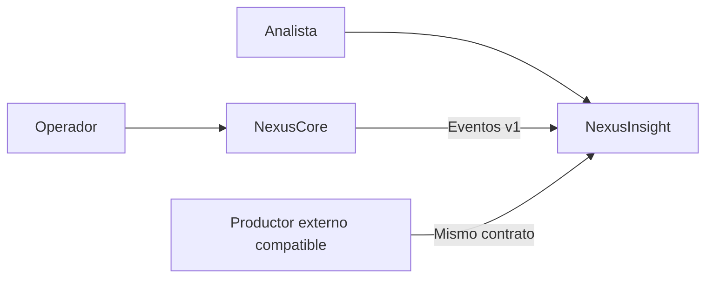
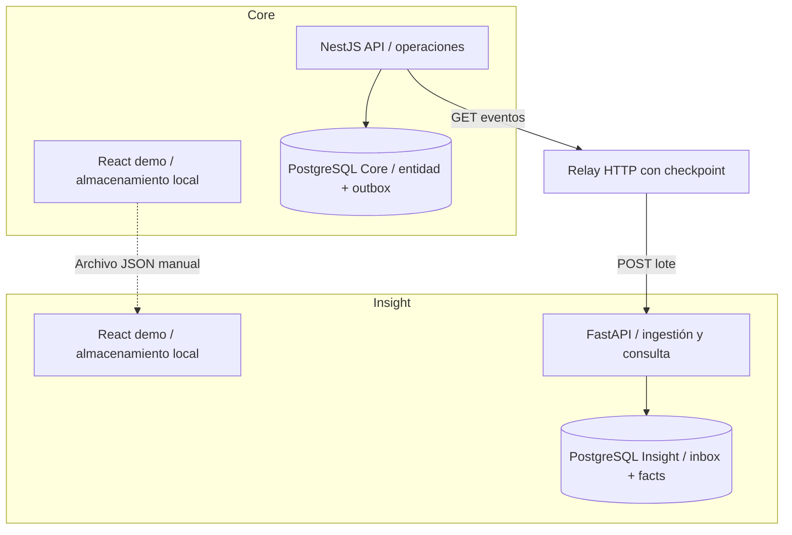

# Nexus Architecture

Arquitectura y contratos del ecosistema **NexusCore + NexusInsight**, creado por Darío Idrovo como portafolio Full Stack y Datos.

| Proyecto | Responsabilidad | Código | Demo React |
| --- | --- | --- | --- |
| NexusCore | Registrar y gestionar operaciones | [Repositorio](https://github.com/idrovodario16/nexuscore-platform) | [Abrir](https://nexuscore-idrovodario16-demo.brownlyric131.chatgpt.site/) |
| NexusInsight | Ingerir snapshots y calcular indicadores | [Repositorio](https://github.com/idrovodario16/nexusinsight-analytics) | [Abrir](https://nexusinsight-idrovodario16-demo.brownlyric131.chatgpt.site/) |

## Cómo funcionan juntos
Core es dueño de las operaciones. Cada alta/cambio escribe una instantánea versionada en outbox, en la misma transacción que la entidad. El relay lee esa outbox por cursor y entrega eventos a Insight. Insight valida el contrato, registra el event_id en inbox y actualiza su modelo analítico solo si la revisión es mayor. Cada producto mantiene su base y puede funcionar de forma autónoma.

Las demos públicas se alojan en Sites; GitHub Pages queda como alternativa configurable. Las demos públicas realizan el mismo intercambio mediante archivos JSON, sin backend ni secretos. No hay sincronización automática entre navegadores o dominios. El backend real y el relay se ejecutan localmente; las interfaces React todavía no incluyen un adaptador conectado a sus APIs.

## C4 · Contexto

## C4 · Contenedores

Las líneas de demo representan transporte manual. React no llama a las APIs en este MVP.

## C4 · Componentes

Core: controlador → caso de uso → puerto de repositorio → adaptador PostgreSQL. Dominio define transiciones y eventos. Insight: rutas/validación → ingesta transaccional → inbox/facts; consultas SQL devuelven indicadores. El relay no accede a las bases: consume contratos HTTP.

## Contratos

- [JSON Schema de evento v1](contracts/operation.upserted.v1.schema.json)
- [Muestra completa](examples/operations.events.json)
- [OpenAPI NexusCore](contracts/nexuscore.openapi.json)
- [OpenAPI NexusInsight](contracts/nexusinsight.openapi.json)
- [Decisiones y garantías](docs/decisions.md)
- [Prueba end-to-end con APIs reales](scripts/integration.mjs)

No se comparte una biblioteca de ejecución obligatoria: cada repositorio incluye una copia del contrato v1 y la misma muestra. Las versiones se actualizan coordinadamente por PR; los hashes deben coincidir. Esto permite clonar, construir y ejecutar cada producto por separado.

## Integración real paso a paso

Clona los tres repositorios como carpetas hermanas. En cada producto copia .env.example a .env y ejecuta docker compose up --build -d. Ejecuta seed en Core si quieres datos ficticios, o crea operaciones mediante API. En Insight el seed es opcional; para demostrar ingestión desde cero, no lo ejecutes.

1. Copia aquí .env.example a .env y configura las mismas claves y organización que usan las APIs.
2. Con Node.js 22.12+, ejecuta `node --env-file=.env scripts/sync.mjs`.
3. Consulta `GET http://localhost:8000/v1/metrics` con la credencial de Insight y X-Organization-ID.
4. Ejecuta el relay otra vez: no debe duplicar facts ni indicadores.

Para verificar automáticamente crear → modificar → sincronizar → consultar → reintentar: `node --env-file=.env scripts/integration.mjs`. Usa únicamente un entorno de prueba con datos ficticios. El script crea una operación nueva en cada ejecución y la conserva para inspección.

El archivo .sync-checkpoint.json contiene solo cursor y direcciones, está ignorado por Git y se confirma después de la ingesta exitosa. Si el proceso cae antes de guardar, reenvía el lote; el consumidor lo deduplica. El relay se ejecuta una vez hasta vaciar la cola; para operación continua prográmalo mediante un servicio externo. No es un broker, CDC ni una promesa de exactly-once.

## Evolución profesional

Comenzamos con monolitos modulares independientes, contratos explícitos y bases separadas. Antes de producción: conectar UI/API; OIDC/RBAC; autorización multi-tenant; auditoría de actor; TLS/rotación; límites de bytes; backups y restauración; migraciones evolutivas; observabilidad; retención outbox/inbox y pruebas de carga. Microservicios, broker y modelos predictivos requieren justificación posterior.

Licencia MIT. Todos los datos y claves de ejemplo son ficticios.

Consulta [cómo se publicaron las demos](docs/deployment.md), sus límites y cómo actualizar el alojamiento.
